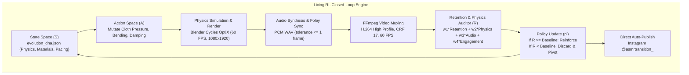

# 🧬 ASMR-Genesis-RL: Autonomous 3D ASMR Reinforcement Learning Pipeline

An autonomous, self-evolving Reinforcement Learning agent and production pipeline dedicated to generating, simulating, auditing, and publishing ultra-photorealistic 3D ASMR Reels matching the aesthetic of top creators (like **@asmrverse3d**).

---

## ⚡ Core Features & Production Standards

1. **60 FPS Progressive Rendering:** All simulations, keyframe curves, Foley events, and encodes run strictly at **60 FPS** (1080x1920 vertical 9:16 format).
2. **Vertex-Level Cloth Pressure Physics:** Replaces fake procedural scaling with hydrostatic pressure volume conservation (`use_pressure=True`), low bending stiffness (`0.04-0.08`), and real contact squish against collision geometry.
3. **PBR Luxury Materials (100% Opaque):** 
   - 100% Opaque Italian Verde Alpi emerald marble with zero light bleed (`Transmission = 0.0`).
   - Pure 24K bullion gold with warm amber specular reflections (`Transmission = 0.0`).
   - Double-wall optical glass (`Glass BSDF`, `IOR = 1.492`).
4. **Action-Synchronized 3D Binaural Foley:** Frame-accurate Foley audio triggers (suction pop, glass glide, marble impact, gelatin squish, slime stretch, liquid slump) aligned within $\le 1$ frame tolerance.
5. **Living Reinforcement Learning Closed Loop:** Computes composite reward $R_{\text{total}} = 0.40 R_{\text{retention}} + 0.30 R_{\text{physics}} + 0.20 R_{\text{audio}} + 0.10 R_{\text{engagement}}$, mutating physics and pacing policies over generations in `evolution_dna.json`.
6. **Direct Instagram Auto-Publishing:** Publishes verified 60 FPS Reels directly to Instagram using cached sessions (`@asmrtransition_`).

---

## 🏗️ System Architecture



---

## 🚀 Quick Start Guide

### Prerequisites
1. **Python 3.10+**
2. **Blender 5.x LTS** installed with NVIDIA GPU OptiX support.
3. **FFmpeg** installed and accessible in your system PATH.

### Installation
```bash
# Clone the repository
git clone https://github.com/pranjalsingh5872/ASMR-Genesis-RL.git
cd ASMR-Genesis-RL

# Install Python dependencies
pip install -r requirements.txt

# Configure environment
cp .env.example .env
# Edit .env with your credentials
```

---

## 🎮 Running the System

### 1. Launch the Living Reinforcement Learning Daemon
Executes the continuous RL loop: mutates physics, renders in Cycles OptiX at 60 FPS, syncs Foley audio, audits retention, and auto-publishes:
```bash
python -m automate --mode rl-daemon --engine blender --fps 60 --device optix --target-account asmrtransition_ --reward-metric retention_loop --auto-evolve --auto-publish
```

### 2. Test Run (Dry-Run Preview)
Run policy mutation and retention audit without uploading to Instagram:
```bash
python -m automate --mode rl-daemon --engine blender --fps 60 --device optix --target-account asmrtransition_ --reward-metric retention_loop --auto-evolve --dry-run
```

### 3. Render 60 FPS Cloth Pressure Scene Directly
```bash
# Render all 300 frames in Blender Cycles OptiX
& "C:\Program Files\Blender Foundation\Blender 5.2\blender.exe" -b -P render_cloth_jelly_60fps.py

# Synthesize action-synchronized Foley audio
python mix_cloth_jelly_audio.py

# Compile 60 FPS MP4 video with FFmpeg
python compile_cloth_jelly_reel.py
```

### 4. Direct Video Quality & Retention Audit
```bash
python retention_auditor.py output/rendered/FINAL_60FPS_CLOTH_JELLY_ASMR.mp4
```

---

## 📂 Project Structure

```
├── automate.py                  # Master CLI entrypoint & RL Daemon orchestrator
├── blender_physics_sim.py       # Cloth Pressure, Collision, & 100% Opaque PBR materials
├── render_cloth_jelly_60fps.py  # 60 FPS Cycles OptiX production render pipeline
├── mix_cloth_jelly_audio.py     # 60 FPS action-synchronized binaural Foley sound mixer
├── compile_cloth_jelly_reel.py  # FFmpeg 60 FPS H.264/AAC muxer and thumbnail extractor
├── retention_auditor.py         # Computer-vision quality gate & composite RL reward auditor
├── evolution_engine.py          # State/Action space mutation and policy gradient updater
├── instagram_publisher.py       # Instagram session publisher with retry & challenge handling
├── upload_cloth_jelly_reel.py   # One-click Reel publisher for target account
├── evolution_dna.json           # Persistent RL state space, physics parameters, and logs
├── CORE_MEMORY.md               # Immutable system directives and agent prompt specifications
├── assets/                      # Curated 3D ASMR Foley audio recordings (WAV)
├── requirements.txt             # Python dependencies
└── .gitignore                   # Excludes credentials, session tokens, and heavy render files
```

---

## 📜 License
MIT License. Built for autonomous creative exploration.
